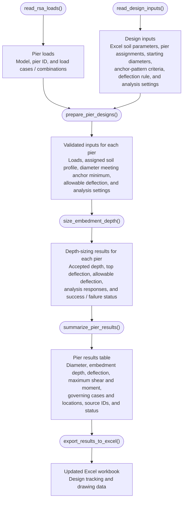

# Drilled Pier Design
## 1. Goal
Size the embedment depth and obtain the maximum shear and moment on the drilled pier from the applied loading

## 2. How it is currentlly done
1. We obtain all of the load cases for each pier
2. We use a program called Allpile to obtain the depth which will keep the pier deflection below the deflection criteria
3. We use the same program to obtain the maximum shear and moment seen by the concrete
4. We next take the depth and loading and place into an excel worksheet to track and create the data required to create the drawings.

## 3. How will I do it?

This overview shows the main functions and the data each function produces. Ovals represent functions; rectangles represent their outputs. Detailed checks and depth iterations are handled inside the functions.

`size_embedment_depth()` builds and runs the OpenSeesPy models, checks top deflection for the applicable load cases / combinations, and adjusts depth within the configured search limits. It returns the first passing trial depth or an explicit failure / unresolved status. `summarize_pier_results()` extracts the shear and moment envelopes for accepted designs and carries unsuccessful pier statuses into the results table.

The diameter-based deflection rule, anchor-pattern minimum diameter criteria, and depth search settings still need to be defined. Specify whether deflection is checked by direction or as a resultant.
