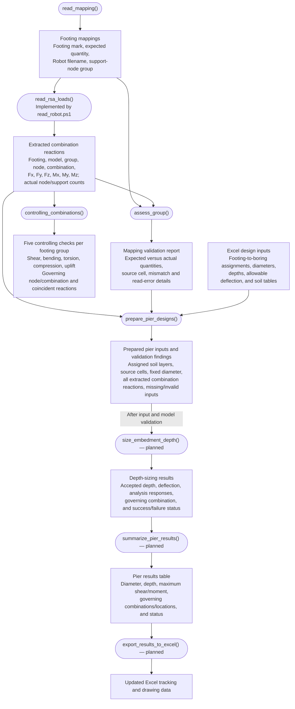

# Drilled Pier Design
## 1. Goal
Size the embedment depth and obtain the maximum shear and moment on the drilled pier from the applied loading

## 2. How it is currentlly done
1. We obtain all of the load cases for each pier
2. We use a program called Allpile to obtain the depth which will keep the pier deflection below the deflection criteria
3. We use the same program to obtain the maximum shear and moment seen by the concrete
4. We next take the depth and loading and place into an excel worksheet to track and create the data required to create the drawings.

## 3. How will I do it?

OpenSeesPy is the planned analysis engine for the pile / drilled pier / caisson workflow. Excel supplies the design inputs and receives the results. The VBA workbook serves as a reference for input organization and optional comparison cases; implementing the new workflow does not depend on repairing or porting its solver.

This overview shows the main functions and their outputs. Ovals represent functions; rectangles represent data. Load extraction, controlling-load reporting, and input preparation are implemented in the [reaction viewer](rsa-reaction-viewer/README.md). OpenSeesPy analysis and result export to Excel remain planned.

The input workbook is `inputs/DVLP_FTG_MTL_QTY.xlsm`. The current mapping is `INPUT TABLES!RSA_GROUP_MAPPING`, with these columns:

| Input | Purpose |
| --- | --- |
| MARK | Footing callout, such as A, B, or C |
| FOOTING QTY | Expected quantity to compare with the Robot group |
| GROUP NAME | Support-node group in the specified Robot model |
| ROBOT FILE NAME | Source model filename/path; different mappings may use different models |

`read_mapping()` reads the saved workbook. Relative Robot paths are resolved from the workbook folder, and `.rtd` is added when omitted. `read_rsa_loads()` is the workflow name for the extraction implemented in `read_robot.ps1`: it opens each mapped model, obtains group membership from Robot, and reads **load combinations only**. Individual load cases are excluded even if their numbers are entered in the selection field. The current reader supports ordinary linear combinations; unsupported combination types are flagged for further implementation.

Each extracted row retains the footing mark, full model path, group, node, combination number/name, and all six global reaction components. Raw API values are retained in N and N-m; the viewer can display kip/kip-ft or kN/kN-m. Components from different nodes or combinations are never combined into a fabricated load vector, and reactions are not summed across supports or models. The reader uses available, current results without recalculating or saving the model; missing or out-of-date results are reported.

`assess_group()` compares Excel's expected quantity with the actual group-node and support counts. Missing models/groups, non-support nodes, failed reads, and quantity mismatches are flagged. The viewer highlights affected rows and identifies the Excel source cell, expected value, actual value, and difference. Unavailable counts are not treated as zero, and the workbook is not automatically corrected.

`controlling_combinations()` reports the following checks separately for each footing callout across its extracted nodes/models:

| Check | Governing criterion |
| --- | --- |
| Maximum shear | Largest `sqrt(Fx² + Fy²)` |
| Maximum bending moment | Largest `sqrt(Mx² + My²)` |
| Maximum torsion | Largest `abs(Mz)`, retaining the signed Mz in the associated reaction row |
| Maximum compression | Largest positive Fz |
| Maximum uplift | Most negative Fz, displayed with its negative sign |

Global Z is treated as vertical; positive Fz denotes compression and negative Fz denotes uplift. Each check identifies its controlling combination, node, model/group, and all six coincident reactions. Different checks may be controlled by different combinations. Exact ties show their count and one deterministic source; absent compression/uplift is reported as “None found.” These are load extremes, not proof of the governing pier deflection or capacity condition. All extracted combination rows are retained for input preparation and subsequent analysis.

`prepare_pier_designs()` joins each footing callout to `INPUT TABLES!tblBoringAssignment`, which supplies its boring, anchor-pattern-based diameter, minimum embedment, water-table depth, and allowable deflection. Soil layers come from the `tblSOIL_BORING_*` tables on `GEOTECH PARAMETERS`: `_03` identifies boring 3 (`SB3`), and the BORING/NUMBER cell above the table is cross-checked. Disagreements, missing/ambiguous assignments, invalid layers, missing numeric inputs, and unconfirmed soil units are reported with source locations. The viewer carries extraction and quantity errors into this validation report.

The intended allowable-deflection source is the diameter-based criteria in `DP WORKFLOW and GUIDELINES!B67:E75`. Until the governing column and override precedence are confirmed, preparation retains the assignment-table allowable value and issues a warning. Missing values are not filled silently. Prepared data and validation findings can be exported to JSON; OpenSeesPy is not run at this stage. See the [viewer documentation](rsa-reaction-viewer/README.md) for the current implementation and the [input workbook inspection](workbook-review/input-workbook.md) for outstanding input questions.

`size_embedment_depth()` builds and runs the OpenSeesPy models using the specified diameter, checks top deflection against the Excel table value for the applicable load combinations, and adjusts depth within the configured search limits. The diameter stays fixed during depth sizing. It returns the first passing trial depth or an explicit failure / unresolved status. `summarize_pier_results()` extracts the shear and moment envelopes for accepted designs and carries unsuccessful pier statuses into the results table.

The depth search settings still need to be defined. Specify whether deflection is checked by direction or as a resultant.

Section stiffness is calculated from the section code and its geometry/material inputs: `C` for circular sections and `R` for rectangular sections. EI is never a fixed user input in this workflow. Circular sections use the specified diameter; rectangular sections require width and depth. The OpenSeesPy implementation must define and validate how the calculated section stiffness is updated during analysis.

Before implementing `size_embedment_depth()` and `summarize_pier_results()`, research and validate how OpenSeesPy provides the required outputs for the selected pier model and element types:

- Select and validate the pier elements, soil interaction model, section stiffness assumptions, and boundary conditions against the intended loading and soil profiles.
- How to retrieve top-of-pier displacement and identify the relevant directions.
- How to retrieve shear and moment along the pier, including output component order, sign conventions, coordinate systems, and response locations.
- How output values relate to the model's unit system and individual load combinations.
- How to identify analysis success, nonconvergence, and incomplete results.

The output of this research will be a documented mapping from OpenSeesPy responses to the workflow's result fields, supported by a small benchmark with independently known deflection, shear, and moment. The analysis-output fields shown above are proposed requirements until this validation is complete.

The existing VBA workbook, `inputs/TEST_SUB_LAT_PILE_PY.xlsm`, provides an optional comparison case and a six-column response layout. See the [workbook inspection](workbook-review/inspection.md) for its input/output mapping and extracted-code findings. Resolve its unit, argument, convergence, and summary-formula issues only if its results will be used for comparison. Begin OpenSeesPy validation with an independently known benchmark, then a representative layered-soil pier case with a trusted comparison solution.
